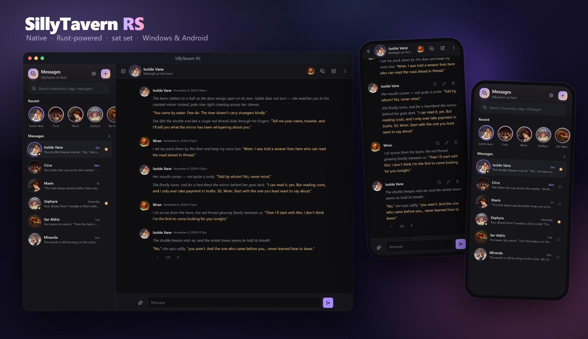
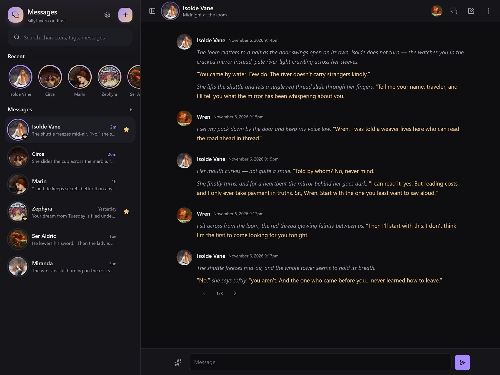
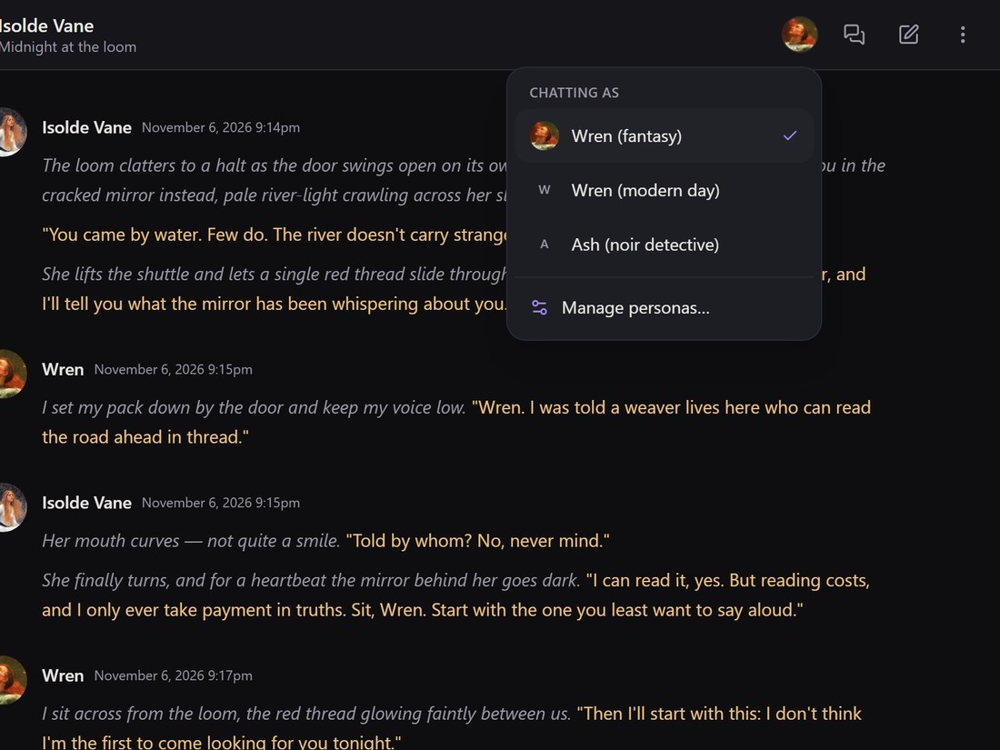
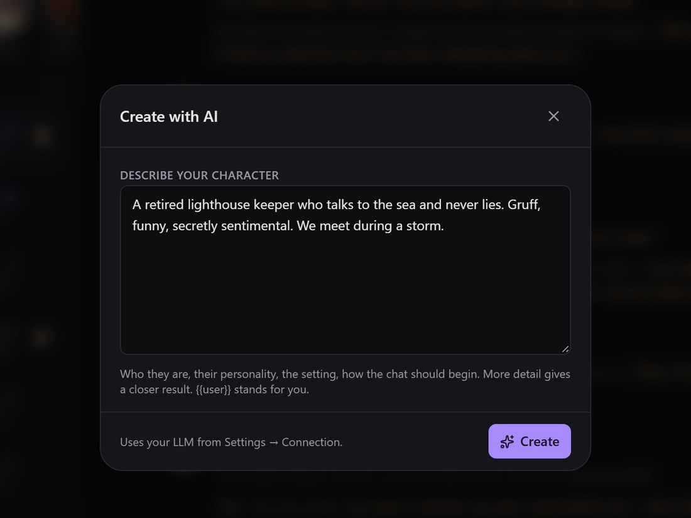
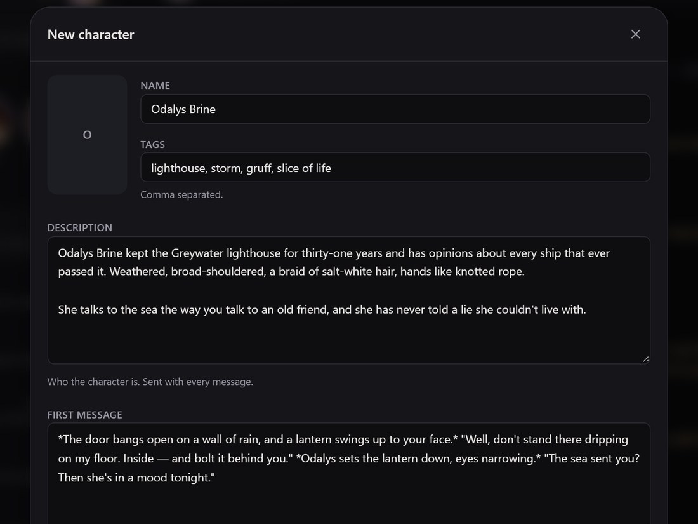
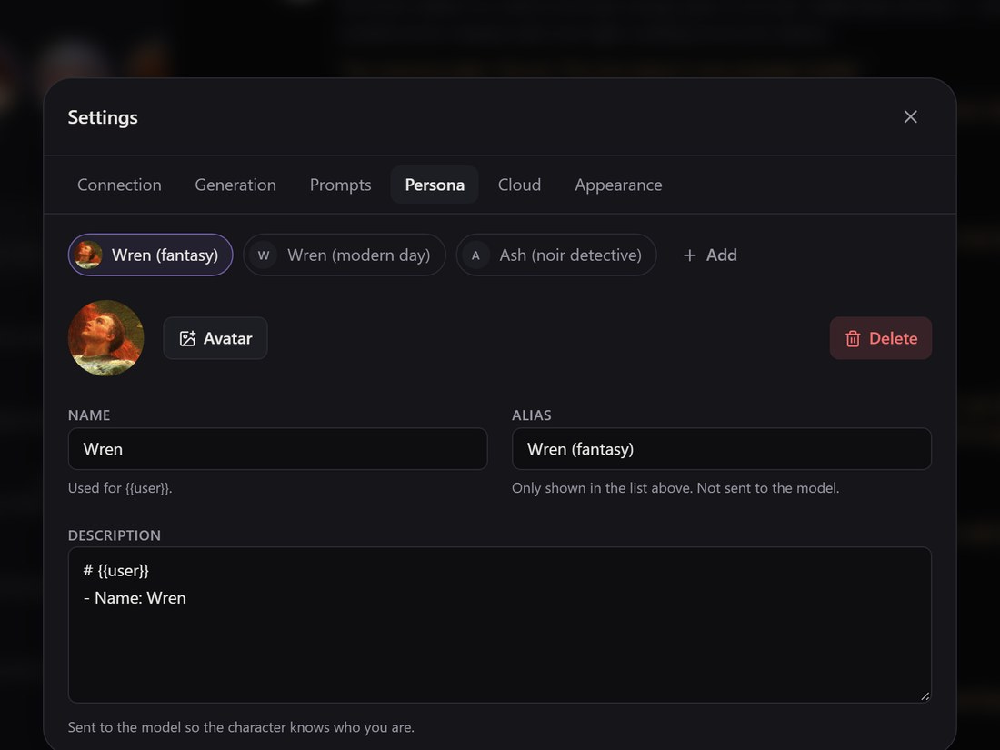
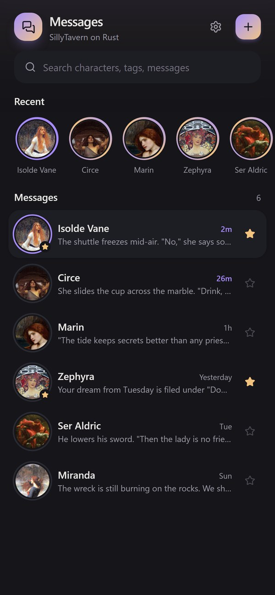
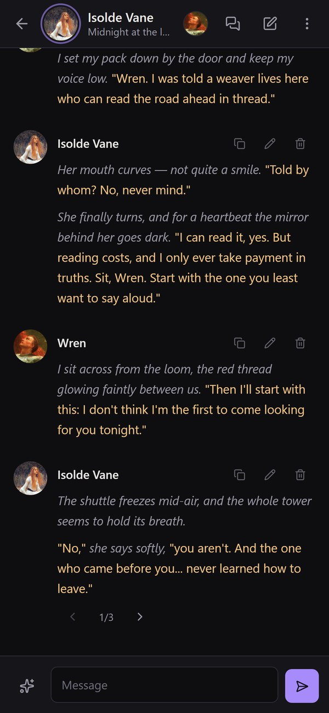
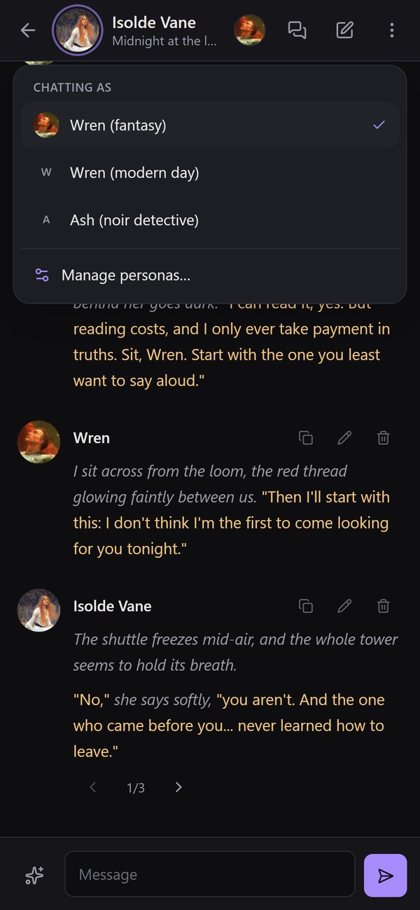

<h1 align="center">SillyTavern RS</h1>

<p align="center"><b>SillyTavern, rebuilt as a native app in Rust.</b><br>
Open it and you are already in the story: no server to start, no long loading screen.</p>

<p align="center">
  
</p>

## Why this exists

I built SillyTavern RS because I got frustrated. SillyTavern is a wonderful piece of
software, but every time I wanted to chat I had to wait for it to load, and the wait was
long. Very long. It never felt *sat set* (Indonesian for quick and snappy, no fuss). All I
wanted was to open the app and be in a conversation.

So I rebuilt the parts I use every day as a native app: a Rust core with a clean React UI,
**no background server**, on Windows and on Android. It reads the same character cards and
chats as SillyTavern, so you can bring your library along and keep going.

## A look around

<p align="center">
  
</p>

Your conversations on the left (recent characters on top, newest chat first), the chat on
the right. Quoted speech is highlighted and *actions* are muted, the usual roleplay look.

| | |
|---|---|
|  |  |
| **Who are you tonight?** Switch persona in one tap from the chat header. Same-named personas stay apart with an alias. | **Create with AI.** Describe the character in your own words; your configured model writes the card. |
|  |  |
| **Review before saving.** The card opens in the editor, filled in. Nothing is saved until you say so. | **Personas with aliases.** An alias is only a label for you; the model still sees the name. |

### On your phone

<p align="center">
  
  &nbsp;
  
  &nbsp;
  
</p>

The same app on Android. Updates download and install from inside the app.

## What it is

A clean rebuild of [SillyTavern](https://github.com/SillyTavern/SillyTavern) as a native
desktop and Android app, using Tauri 2 + Rust with a React UI.

There is no background server. Everything the old Express server did (character cards,
chats, prompt building, calling LLM APIs) runs in-process in Rust and stops when the
app closes. The UI talks to Rust through Tauri commands; replies stream over a Tauri channel.

## Features (current)

- Character cards: import PNG (V2 `chara` / V3 `ccv3`) and JSON (V1, Pygmalion, V2, V3),
  create, edit, delete, favorites, avatar upload. Unknown card fields are preserved.
- Chats in SillyTavern's JSONL format: multiple chats per character, rename, delete,
  greetings with alternate greetings as swipes.
- Generation: send, stop, regenerate (new swipe), swipe left/right, continue, impersonate,
  edit/delete/copy messages, reasoning display.
- Providers: any OpenAI-compatible API (OpenAI, OpenRouter, DeepSeek, Groq, Ollama,
  LM Studio, KoboldCpp, llama.cpp), Anthropic Claude, Google Gemini. Streaming via SSE.
- Prompt builder in SillyTavern's default order (main prompt, persona, description,
  personality, scenario, examples, history, post-history instructions) with a context
  budget, macros (`{{char}}`, `{{user}}`, `{{random}}`, `{{roll}}`, dates, ...) and a
  prompt inspector.
- Personas with avatars and aliases, dark/light theme, text size, mobile layout.
- Create with AI: describe a character in plain words and your configured model writes the
  card, which opens in the editor to review before it is saved.
- HTML comments (`<!-- ... -->`) in replies are kept in the chat but not shown.
- Import cards from a file, by dropping files (or a card link) on the sidebar, or from a URL:
  Chub, JanitorAI (JannyAI), Pygmalion, AICharacterCards, RisuRealm or a direct PNG/JSON link.
- Optional cloud sync with your own server (`server/`): local-first, works offline, asks
  which copy to keep when the same item changed on two devices; API keys are encrypted
  with your passphrase before upload. First start asks "this device only" or "cloud server";
  change it later in Settings → Cloud. Deploy guide: [server/README.md](server/README.md).
  The server also has one endpoint, `POST /api/v1/characters`, to push a PNG or JSON character
  card to all your devices from a script or `curl` (see the server README).

Not yet ported: World Info / lorebooks, group chats, tokenizers (token counts are
estimates), Text Completion backends, extensions, STscript.

## Data

Same layout as SillyTavern's `data/default-user/`, so existing data can be copied in:

```
characters/*.png        chats/<character>/*.jsonl
User Avatars/*.png      worlds/
settings.json           secrets.json
```

Location: the OS app-data folder (`%APPDATA%\com.sillytavern.rs` on Windows, app-private
storage on Android). On desktop, set `SILLYTAVERN_RS_DATA` to use another folder.
API keys are stored in `secrets.json` in plain text, as SillyTavern does.

## Layout

```
src-tauri/src/
  lib.rs              app setup, command registration
  commands.rs         every UI -> Rust command
  state.rs            in-process state (settings, caches, running generations)
  paths.rs            data folders, safe file names, atomic writes
  png_meta.rs         PNG tEXt chunk read/write
  character.rs        card parsing, import, create/update/delete
  chat.rs             JSONL chats
  settings.rs         settings, personas, secrets
  macros.rs           {{macro}} substitution
  prompt.rs           prompt builder + context budget
  providers/          openai.rs, claude.rs, gemini.rs, sse.rs
  avatar_protocol.rs  avatar:// images + thumbnails
src/
  lib/                types, api (invoke wrappers), store (zustand), utils
  components/         Sidebar, ChatView, MessageItem, Composer, SettingsSheet,
                      CharacterEditor, ChatsPanel, PromptInspector, ui
```

## Develop

Requirements: Rust (stable), Node 20+, pnpm. For Android: Android SDK + NDK and JDK 17/21.

```bash
pnpm install
pnpm tauri dev                 # desktop
cd src-tauri && cargo test     # Rust unit tests
```

### Android

```bash
pnpm tauri android dev                                   # run on a device/emulator
pnpm tauri android build --apk --target aarch64 --debug  # installable debug APK
```

Environment used on the original machine (everything off the system drive):

```
ANDROID_HOME=D:\Android\Sdk
NDK_HOME=D:\Android\Sdk\ndk\25.2.9519653
JAVA_HOME=D:\Software\AndroidStudio\AS\jbr
GRADLE_USER_HOME=D:\GradleCache
RUSTUP_HOME=D:\Software\Rust\rustup
CARGO_HOME=D:\Software\Rust\cargo
```

## Releases and auto-update

No server is needed: GitHub Actions builds everything and GitHub Releases hosts it.

1. Bump the version and tag it (the tag must match `package.json`):
   ```bash
   npm version patch        # or minor / major; creates commit + tag vX.Y.Z
   git push --follow-tags
   ```
2. `.github/workflows/release.yml` creates a draft release, builds the Windows
   installer (signed for the updater, plus `latest.json`) and the signed Android APK,
   then publishes the release.
3. Apps check on start (and from Settings → Appearance → Check for updates):
   - **Windows**: `tauri-plugin-updater` downloads, verifies the signature, installs, restarts.
   - **Android**: the app finds the newer GitHub release, downloads its APK itself (only
     this repository's release assets) and opens Android's installer; the user confirms.
     The first time, Android asks to allow "Install unknown apps" for the app; after that
     updates never need a browser or GitHub. Android only accepts the APK when it is signed
     with the same key as the installed app. (Updating *to* the first version that has this
     is still the old way: install that APK once by hand.)

Only published releases count. Tags with a suffix (`v1.2.0-beta.1`) become prereleases
and never show the popup.

Required repository secrets (Settings → Secrets and variables → Actions):

| Secret | Value |
|---|---|
| `TAURI_SIGNING_PRIVATE_KEY` | content of the updater private key |
| `TAURI_SIGNING_PRIVATE_KEY_PASSWORD` | its password |
| `ANDROID_KEYSTORE_BASE64` | the release keystore, base64-encoded |
| `ANDROID_KEYSTORE_PASSWORD` | keystore/key password |
| `ANDROID_KEY_ALIAS` | key alias |

### Building the APK on your own VPS (optional)

GitHub's runners are free for public repositories, so a VPS is not required. If you
prefer your own machine (persistent caches, no queue), the Android job can run on a
self-hosted runner while releases still go to GitHub:

1. VPS: Ubuntu/Debian **x86_64** (the NDK has no ARM Linux host tools), 2+ vCPU,
   8 GB RAM (or 4 GB + swap), 25 GB free disk.
2. On your PC, get a registration token (valid 1 hour):
   ```bash
   gh api -X POST repos/faizonly5953/sillytavern-on-rust/actions/runners/registration-token --jq .token
   ```
3. On the VPS, as a normal user with sudo:
   ```bash
   curl -fsSLO https://raw.githubusercontent.com/faizonly5953/sillytavern-on-rust/main/scripts/setup-vps-runner.sh
   RUNNER_TOKEN=<token> bash setup-vps-runner.sh
   ```
   It installs JDK 21, the Android SDK + NDK and the runner as a systemd service.
4. Point the workflow at it (undo with `gh variable delete ANDROID_RUNNER`):
   ```bash
   gh variable set ANDROID_RUNNER -R faizonly5953/sillytavern-on-rust --body '["self-hosted","linux","android"]'
   ```

Only the tag-triggered release workflow uses the VPS; `ci.yml` (which also runs for pull
requests from strangers) stays on GitHub's runners so untrusted code never reaches your
server. The Windows installer is always built on GitHub's Windows runner.

Keep the private key and keystore backed up outside the repository. Losing the updater key
breaks desktop auto-update; losing the keystore means Android users must uninstall and
reinstall to get new versions.

## Credits

### Built with Claude

I'll be honest: I couldn't have built something this complex without Claude. SillyTavern RS
was written together with [Claude](https://claude.com) through
[Claude Code](https://claude.com/claude-code): the Rust core, the React UI, the Android
in-app updater, the CI and releases, and even the screenshots above. I say what I want and
how it should feel; Claude writes and checks the code with me. It is credited as co-author
in the commit history.

### Screenshots

The characters and conversations in the screenshots are made up for this demo. The
character images are public-domain paintings from Wikimedia Commons:

- Isolde Vane: John William Waterhouse, [*The Lady of Shalott*](https://commons.wikimedia.org/wiki/File:John_William_Waterhouse_The_Lady_of_Shalott.jpg) (1888)
- Circe: Waterhouse, [*Circe Offering the Cup to Ulysses*](https://commons.wikimedia.org/wiki/File:Circe_Offering_the_Cup_to_Odysseus.jpg) (1891)
- Marin: Waterhouse, [*A Mermaid*](https://commons.wikimedia.org/wiki/File:John_William_Waterhouse_A_Mermaid.jpg) (1900)
- Miranda: Waterhouse, [*Miranda - The Tempest*](https://commons.wikimedia.org/wiki/File:Waterhouse_miranda_the_tempest.jpg) (1916)
- Zephyra: Alphonse Mucha, [*Reverie*](https://commons.wikimedia.org/wiki/File:Reverie_1897.jpg) (1897)
- Ser Aldric and Wren: Frank Dicksee, [*La Belle Dame sans Merci*](https://commons.wikimedia.org/wiki/File:Dicksee_Frank,_La_Belle_Dame_Sans_Merci.jpg) (1902)

## License

AGPL-3.0, like SillyTavern.
